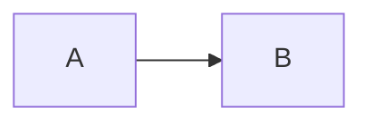

# Blog content

Each `*.mdx` (or `*.md`) file in this folder becomes a post at `/blog/<slug>`.

## Frontmatter

```yaml
---
title: Required — the post title
description: Required — used as the OpenGraph and index summary
publishedAt: YYYY-MM-DD (required)
updatedAt: YYYY-MM-DD (optional)
tags: [optional, list, of, tags]
cover: /path/to/og.png (optional, relative to /public or absolute URL)
draft: false   # if true, hidden in production but visible in dev
author: Zaheed Shaikh
---
```

## Authoring

- Run `pnpm dev` and visit `/blog/editor` to write with a live preview that
  uses the exact same renderer as production posts.
- The editor persists your draft to `localStorage` and lets you download the
  final `.mdx` file. Drop the download into this folder to publish.
- Drafts (`draft: true`) are visible in dev but excluded from production
  builds.

## Diagrams

Fence with `mermaid` and the client will render the diagram on mount:

````md

````

## Code

All fenced code blocks are syntax-highlighted at build time via Shiki using the
project themes (`min-light` / `min-dark`).
