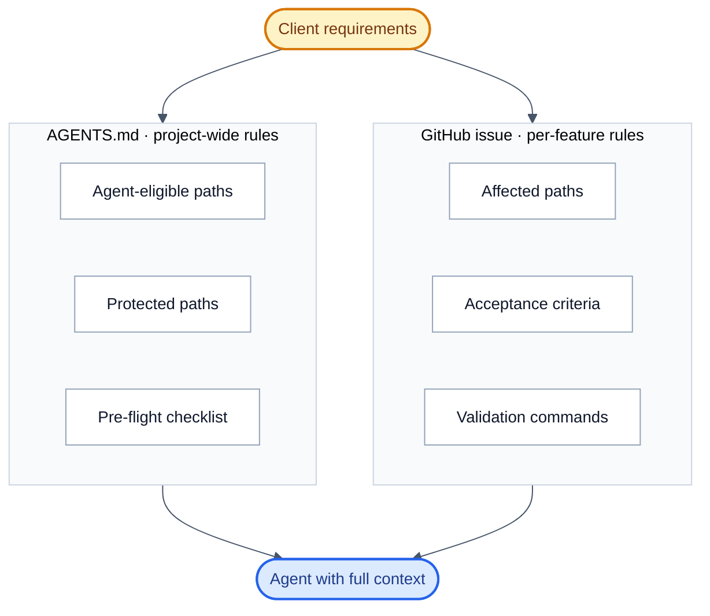
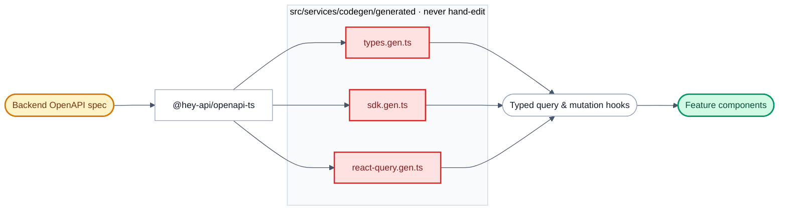
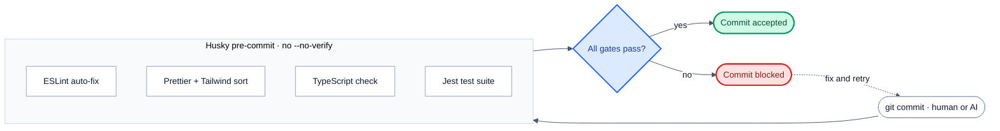
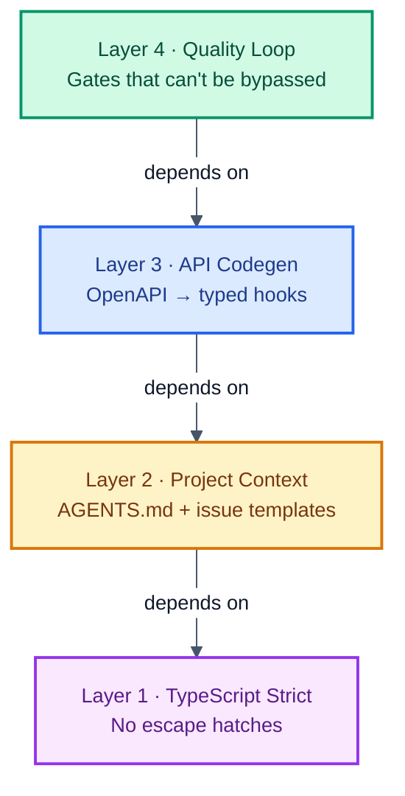

*Using React Native as the case study — but the workflow applies to any complex frontend project.*

---

There are two camps forming in software. One thinks AI agents will replace engineers. The other thinks engineers, given the right setup, can ship in weeks what used to take months — without compromising on what "production-ready" actually means. This post is from the second camp, and it's two years of figuring out what "the right setup" actually requires when you're shipping to real users.

About a year ago, I tried Cursor. It felt promising, but bugs and slowness pushed me back to plain VS Code. Not long after, I discovered Copilot's IDE extension — and then, eventually, its "agent mode," with Claude, Gemini, and others under the hood.

I didn't trust it for autonomous work at first. For months I lived in "ask mode" — using it for the brain-numbing grunt work I knew how to do but didn't want to do for the hundredth time. Only after I'd already reasoned through a change would I flip into "agent mode" and let it apply the edits.

Then I started supercharging it. Custom skills, MCP servers, plugins — every roadblock the agent hit became a tool I bolted on. Agents missing up-to-date library docs? Context7 fed them the latest. Copy-pasting context out of Jira? The Atlassian MCP server read tickets directly. Copilot fumbling the GitHub CLI? The GitHub MCP server handled PRs and issues cleanly. The agent went from "useful for grunt work" to a real collaborator — once I gave it the right hands and eyes.

I tested all of this on something real. My father runs a small battery shop, and I rebuilt the way they operate. A GST calculator. Charging and jumpstart tracking with photo uploads. Warranty card image storage. A scrap calculator. I wired in the Gemini API with Google Search so they could pull real-time competitive pricing for vehicle and inverter batteries and products based on location. And I shipped them an [SEO-tuned website](https://rbatteries.store/) for emergency jumpstarts and battery services — the kind of site that actually brings local customers in through search. End to end, and that too on weekends.

Around the same time, GitHub kept shipping the updates that changed what was possible. AI code reviews on PRs. Cloud-based task delegation — assign a task before bed, wake up to a finished PR. That part felt genuinely magical.

But the seams started showing. I work across a lot of stacks — React Vite, Electron desktop apps, Next.js, Angular, Ionic hybrid apps, basically every major JS framework you can name. The products I ship are complex and have to be robust. The more I pushed agents into autonomous work on those projects, the clearer the limit became: agents are bounded by their training data. Without rigid structure around them, they confidently generate code that breaks your patterns, touches files they shouldn't, and quietly bypasses the conventions you spent weeks establishing.

I'd dismissed Spec-Driven Development the first time I came across it. Felt like overhead. But once I was shipping market-ready products instead of just closing tickets, the calculus flipped. SDD wasn't overhead — it was the structure that finally let agents work autonomously without breaking things. I picked up the GitHub Spec Kit, and the constitution it generates became my contract with every agent on every project. On top of that I'm now planning much larger automations — automated API and type generation, TanStack Query hook generation, the whole codegen layer — because the spec gives agents a foundation solid enough to build on.

That gap — between "AI tool" and "AI-native workflow" — is what this post is about.

I'm a Senior AI Native Product Engineer at [Shuru](https://shurutech.com). Five years into this work, across ten-plus industries — maritime, banking, EdTech, logistics, energy, healthcare, e-commerce, NGO, and compliance — across four companies that each taught me something different about what "production-grade" means. I joined Shuru about six months ago and was onboarded onto three production React Native apps within days. **All three are live on Play Store, two also on App Store, and the third's iOS build is in flight — all on the same workflow** — the strongest proof I have that this is a repeatable system, not a one-off setup. Across those projects: **100,000+ lines of code so far**, shipped on a workflow that finally felt worth calling AI-native. I'll walk through every piece of it, and I'll be honest about where Claude Code CLI pulled ahead of Copilot's agent mode once I ran both side by side.

That last six months at Shuru is where this workflow crystallized. Shuru is the kind of place where engineers are expected to design their own AI workflow rather than just consume one — and where the bar for what "production-ready" means doesn't move just because you're shipping faster. That's the bet the rest of this post explains in detail.

One thing I want to be clear about before we get into any specifics: the tools I use — TanStack Query, NativeWind, hey-api — are answers to questions, not prescriptions. The questions are what matter, and they apply to any stack. If you're on Next.js, Vue, or a Django backend with a TypeScript frontend, the implementation looks different but the thinking is identical. I'll cover that thinking explicitly before we touch any code.

---

## Table of Contents

1. [A Feature Shipped, Start to Finish](#start-here-a-feature-shipped-start-to-finish)
2. [Five Questions Every AI-Native Engineer Should Ask](#the-thinking-behind-the-stack-five-questions-every-ai-native-engineer-should-ask)
3. [The Foundation: TypeScript Strict Mode](#the-foundation-typescript-strict-mode)
4. [Giving AI the Right Context](#giving-ai-the-right-context)
5. [The API Layer: 100% Automated](#the-api-layer-100-automated)
6. [The Frontend Foundation](#the-frontend-foundation-where-3040-gets-automated)
7. [The Quality Loop](#the-quality-loop-guardrails-that-cant-be-bypassed)
8. [Testing: QA-Driven, AI-Implemented](#testing-qa-driven-ai-implemented)
9. [Security and Maintenance](#security-and-maintenance)
10. [What This Workflow Ships](#what-this-workflow-ships)
11. [How It All Fits Together](#how-it-all-fits-together)
12. [What to Try on Monday Morning](#what-to-try-on-monday-morning)
13. [Closing Thoughts](#closing-thoughts)

---

## Start Here: A Feature Shipped, Start to Finish

Before TypeScript config, before codegen, before any of the tooling — here's what this workflow looks like when it runs. One feature, end to end.

```mermaid
%%{init: {'theme':'base','themeVariables':{'primaryColor':'#ffffff','primaryTextColor':'#0f172a','primaryBorderColor':'#94a3b8','lineColor':'#475569','edgeLabelBackground':'#ffffff','fontFamily':'ui-sans-serif,system-ui,sans-serif','fontSize':'14px'},'flowchart':{'nodeSpacing':50,'rankSpacing':65,'padding':14,'useMaxWidth':true,'htmlLabels':true,'curve':'basis'}}}%%
flowchart LR
    A(["1 · Issue created"])
    B(["2 · AGENTS.md loaded"])
    C(["3 · Issue read by agent"])
    D{"4 · API spec changed?"}
    E(["Run codegen"])
    F(["5 · Agent implements"])
    G{"6 · Pre-commit gates"}
    H(["7 · PR + Copilot review"])
    I(["8 · Human review + merge"])
    J(["9 · Semantic release"])

    A --> B --> C --> D
    D -->|yes| E --> F
    D -->|no| F
    F --> G
    G -->|fail| F
    G -->|pass| H --> I --> J

    classDef context fill:#FEF3C7,stroke:#D97706,stroke-width:2px,color:#78350F;
    classDef decision fill:#DBEAFE,stroke:#2563EB,stroke-width:2px,color:#1E3A8A;
    classDef done fill:#D1FAE5,stroke:#059669,stroke-width:2px,color:#064E3B;

    class B,C context
    class D,G decision
    class J done
```



**Figure 1.** The full AI-native feature delivery workflow — from ticket to merged PR.

Each node has specific infrastructure behind it. The rest of this post explains each one in the order they depend on each other.

Three things worth noticing before we go deeper:

**Steps 2 and 3 are both context delivery.** The constitution covers project-wide rules; the issue covers per-feature rules. Together they answer: what should the agent know before it starts? → [Giving AI the Right Context](#giving-ai-the-right-context)

**The codegen step is the part that surprises people most.** The entire API layer — types, fetch functions, query hooks — is generated from the backend spec. No hand-written API code. → [The API Layer](#the-api-layer-100-automated)

**The quality gates are what make the whole thing trustworthy.** An AI that can't bypass your checks has to produce correct output, not just plausible-looking output. → [The Quality Loop](#the-quality-loop-guardrails-that-cant-be-bypassed)

---

## The Thinking Behind the Stack: Five Questions Every AI-Native Engineer Should Ask

Before any implementation, there are five questions worth asking. Every decision in this workflow is a direct answer to one of them. I didn't pick TanStack Query because it's popular or NativeWind because my team knew Tailwind. They gave better answers to these questions than the alternatives.

This is the part of the post that has nothing to do with React Native.

**1. Does the tool give agents an unambiguous, machine-readable contract?**

If your type system has escape hatches — `any`, loose API responses, runtime-inferred shapes — the agent fills the gaps with plausible guesses. Sometimes right. Often wrong.

| Mine | Other stacks |
| --- | --- |
| TypeScript strict mode + full API codegen from OpenAPI. No gap to guess at. → [The Foundation](#the-foundation-typescript-strict-mode), [The API Layer](#the-api-layer-100-automated) | tRPC, GraphQL with typed codegen, shared Zod schemas. The contract has to be explicit, machine-readable, and structurally impossible to drift. |

**2. Has the AI been trained on this pattern at massive scale?**

Models produce better output for patterns they've seen millions of times than ones they've seen a few hundred. Tailwind sits in a significant slice of every public codebase. A bespoke internal styling system sits in zero of them. Every departure from what the model knows well is a departure from where it performs best.

| Mine | Other stacks |
| --- | --- |
| NativeWind, conventional commits, standard REST, TanStack Query's documented patterns. → [The Frontend Foundation](#the-frontend-foundation-where-3040-gets-automated) | Standard Vue composition API, idiomatic Rails, well-documented Nuxt conventions — better starting points than custom abstractions that exist only in your codebase. |

**3. Can I draw a hard, enforced boundary between generated and hand-crafted code?**

When an agent can't tell the two apart, it eventually edits the wrong one — confidently.

| Mine | Other stacks |
| --- | --- |
| The generated directory is excluded from lint, excluded from typecheck, and listed as protected in `AGENTS.md` with the reason stated. Three enforcement layers. → [Security and Maintenance](#security-and-maintenance) | Prisma client, GraphQL fragments, any codegen output. Same treatment: explicit, enforced, reasoned. |

**4. Do my quality gates run automatically, with no bypass available?**

A gate that can be skipped under pressure isn't a gate. Agents don't skip them out of laziness — they skip them when the constitution allows it.

| Mine | Other stacks |
| --- | --- |
| Husky hooks on every commit. `--no-verify` listed as prohibited in `AGENTS.md`. TypeScript, ESLint, and the full Jest suite run for every contributor, human or AI. → [The Quality Loop](#the-quality-loop-guardrails-that-cant-be-bypassed) | Husky works everywhere JavaScript lives. The prohibition in the agent's operating rules is the load-bearing part, not the tool. |

**5. Is the project's context written down in a form every AI tool can read?**

Every agent starts from zero context unless you provide it. If that context lives in one tool's config (a `.github/copilot-instructions.md` that Cursor can't read), you've created a split brain.

| Mine | Other stacks |
| --- | --- |
| A single `AGENTS.md` generated by Spec Kit, committed to the repo. Every AI that reads context reads it. → [Giving AI the Right Context](#giving-ai-the-right-context) | Completely stack-independent. The most directly transferable piece of the entire workflow. |

These five questions are the actual workflow. Everything else is just how I answered them for a React Native project. Your answers will look different. The workflow they produce will be just as effective.

That's first-principles thinking — not "what does everyone else use?" but "what does my project need from an AI agent, and what tool answers that most precisely?"

With that framing established, here's the implementation.

---

## The Foundation: TypeScript Strict Mode

*Answers question 1 — the agent writes against types, and those types have to be accurate.*

Every other part of this workflow depends on TypeScript being strict. Not just `strict: true` in your tsconfig — the ESLint config enforces the same discipline.

```json
{
  "compilerOptions": {
    "strict": true,
    "target": "ES2022",
    "module": "ESNext",
    "moduleResolution": "bundler",
    "noEmit": true,
    "paths": { "@/*": ["./src/*"] }
  }
}
```

```javascript
rules: {
  '@typescript-eslint/no-explicit-any': 'error',
  'react-native/no-inline-styles': 'error',
}
```

`no-explicit-any` closes the escape hatch — when an AI agent hits a type it doesn't understand, it has to solve the problem correctly rather than writing `any` and moving on. That forces better output, not just faster output.

`no-inline-styles` is React Native-specific but the reasoning generalises. AI agents default to `style={{ marginTop: 8 }}` because that's what most React Native code in their training data looks like. With NativeWind, every style is a `className`. One rule, and you stop correcting the same mistake repeatedly.

When the codegen step runs, the generated types land in a codebase that's already strict. The type chain from spec to screen is unbroken — the agent consuming those types can't work around them.

---

## Giving AI the Right Context

*Answers question 5 — covers steps 2 and 3 from the overview.*

The most common mistake when adopting AI agents is giving them no project awareness. The agent doesn't know which files are protected, which directory is generated, what package manager the project uses, or what a valid commit looks like. You have to provide that context explicitly — in a form every tool can read.

Two things deliver it: the project constitution (project-wide rules) and the issue template (per-feature rules).



**Figure 2.** Context delivery flow — from client requirements to an agent that knows what to build, how to build it, and what not to touch.

### The Project Constitution — Spec Kit + AGENTS.md

[Spec Kit](https://speckit.org) is an open-source Spec-Driven Development toolkit stewarded by the Linux Foundation [[1]](#ref-1) [[2]](#ref-2). It standardises how we onboard AI agents to a codebase.

When you initialize a project using `specify init`, your workspace gets pre-configured with agent capabilities [[1]](#ref-1) [[2]](#ref-2). Running the `/constitution` command allows you to establish your non-negotiables, which are written directly into `AGENTS.md` [[2]](#ref-2) [[3]](#ref-3).

Because `AGENTS.md` is an open repository-level standard recognized by Codex CLI, Cursor, and Copilot CLI, it serves as your universal source of truth [[3]](#ref-3). However, if you are using Claude Code, it looks natively for a `CLAUDE.md` file [[3]](#ref-3).

To avoid split-brain configurations where you have to duplicate rules across `AGENTS.md` and `CLAUDE.md`, use a **Layered Context Strategy** [[4]](#ref-4):
1. Maintain your detailed rules in the universal `AGENTS.md` file.
2. Keep a minimal `CLAUDE.md` that simply points Claude Code to the shared file.

Here is what the minimal `CLAUDE.md` looks like:

```markdown
# CLAUDE.md

Strictly follow the project rules and conventions defined in ./AGENTS.md.

## Claude-Specific Preferences
- When compacting, preserve the full list of modified files.
- Prefer subagents for deep research tasks.
```

And here is the canonical `AGENTS.md` generated by Spec Kit's `/constitution` command:

```markdown
# AGENTS.md

## Pre-flight Checklist (run before every task)

1. `pnpm typecheck` — TypeScript must pass
2. `pnpm lint` — ESLint must pass
3. `pnpm test` — All tests must pass

## Agent-Eligible Paths (no approval needed)

src/components/ src/hooks/ src/features/ src/stores/
src/navigation/ src/lib/ docs/ src/**/*.test.{ts,tsx}

## Protected Paths — Ask Before Touching

| Path                                  | Reason                        |
| ------------------------------------- | ----------------------------- |
| android/, ios/                        | Native build / signing        |
| .github/workflows/                    | CI/CD automation              |
| src/contexts/auth.token-repository.ts | Security: token storage       |
| src/services/codegen/generated/       | Auto-generated — run codegen  |
| src/config/env.config.ts              | Secrets-adjacent env contract |
```

Notice `src/services/codegen/generated/` in the protected list — that's the same directory populated in [The API Layer](#the-api-layer-100-automated). Any agent that tries to hand-edit it instead of running codegen is breaking the workflow, and the constitution makes that explicit.

When I was running on Copilot's agent mode, a well-maintained constitution noticeably improved output quality. When I moved to Claude Code CLI, the difference was that Claude Code actively reasons about the constitution across the full task lifecycle — it stops before touching a protected path and asks. It reads the pre-flight checklist and runs it. The constitution goes from being context the agent happens to have to being rules the agent genuinely follows.

### The Issue Template — Per-Feature Context

The constitution tells the agent how the project works. The issue tells it what to build right now.

Every issue template includes an **Agent Eligibility** section:

```markdown
## 🤖 Agent Eligibility

- [ ] This story is safe for autonomous agent execution

- **Affected paths:** <!-- e.g. src/features/users/ -->
- **Protected paths touched:** <!-- android/, ios/, auth* — if none, write N/A -->

- **Acceptance criteria (machine-readable):**
  - Given:
  - When:
  - Then:

- **Validation steps:**
  pnpm typecheck
  pnpm lint
  pnpm test
```

When an agent picks up a ticket via `gh` CLI, it gets: which paths are expected to change, whether protected paths are involved (triggering human approval), machine-readable acceptance criteria in Gherkin format, and the exact validation commands to run.

One thing on test quality that comes out of this: AI-generated tests have a reliable failure mode — they test implementation details instead of observable behaviour. The fix: QA defines test cases in the issue before development starts. Engineers and AI agents implement them. One constraint, and you've eliminated an entire class of tests that look thorough and prove nothing. More on this in [Testing](#testing-qa-driven-ai-implemented).

---

## The API Layer: 100% Automated

*Answers questions 1 and 3 — step 4 from the overview.*

I've come to codegen the way you come to most things in this work — by doing the alternative for years first. Five years of writing API code by hand, across banking, logistics, maritime, e-commerce, and more. The pattern that keeps surfacing: a backend engineer renames three fields, three screens silently break. You write throttle and debounce logic by hand, get it almost right, then realize on the third project that you've reinvented stale-while-revalidate. You tune request lifecycle for performance, then re-tune it when quality slips on a slow 3G connection. You add retry semantics, then add deduplication on top of the retries, then chase down a memory leak in your own cache layer. Every project, the same tax, paid by hand. I know these tools because I've used the alternatives — codegen replaced the entire layer once the pain compounded enough to make the trade obvious.

Your backend exposes an OpenAPI spec. `@hey-api/openapi-ts` reads the spec and generates TypeScript types, SDK fetch functions, and TanStack Query hooks [[5]](#ref-5) [[6]](#ref-6). TanStack Query consumes those hooks and handles caching, background refresh, pagination, and request lifecycle [[6]](#ref-6).



**Figure 3.** API codegen pipeline — from OpenAPI spec to fully-typed feature components with zero hand-written API code.

Modern versions of `@hey-api/openapi-ts` (v0.63+) use a clean, plugin-based architecture [[5]](#ref-5). The entire configuration looks like this:

```typescript
// openapi-ts.config.ts
import { defineConfig } from '@hey-api/openapi-ts';

export default defineConfig({
  input: 'src/services/codegen/OpenAPI-Specs.json',
  output: 'src/services/codegen/generated',
  plugins: [
    '@tanstack/react-query', // Generates the TanStack Query options & hooks
  ],
});
```

Running `pnpm openapi-ts` populates `src/services/codegen/generated/` with three core files: `types.gen.ts` (types), `sdk.gen.ts` (raw fetch clients), and `react-query.gen.ts` (query and mutation hooks) [[5]](#ref-5) [[6]](#ref-6). No hand-written code. No manual sync.

### What a Generated Hook Looks Like in Use

The naming follows the OpenAPI operation IDs your backend defines — consistent and discoverable:

```typescript
// Generated — never hand-edit this file
export const usersGetUserActivityOptions = (
  options?: Options<UsersGetUserActivityData>,
) =>
  queryOptions<
    UsersGetUserActivityResponse,
    DefaultError,
    UsersGetUserActivityResponse,
    ReturnType<typeof usersGetUserActivityQueryKey>
  >({
    queryFn: async ({ queryKey, signal }) => {
      const { data } = await usersGetUserActivity({
        ...options,
        ...queryKey[0],
        signal,
        throwOnError: true,
      });
      return data;
    },
    queryKey: usersGetUserActivityQueryKey(options),
  });
```

And a component consuming it — AI-written, wired to the generated hook:

```typescript
import { usersGetUserActivityOptions } from '@/services/codegen/generated/@tanstack/react-query.gen';
import { useQuery } from '@tanstack/react-query';

function UserActivityTab({ userId, headers }: Props) {
  const { data, isLoading, isError } = useQuery({
    ...usersGetUserActivityOptions({
      path: { userId },
      headers,
    }),
    enabled: !!userId && headers.accountid.length > 0,
  });

  if (isLoading) return <ActivityIndicator />;
  if (isError) return <ListEmptyState />;

  // TypeScript knows every field shape of `data` here
}
```

No custom hook. No manual types. The agent writing this works from the same ground truth as the backend. Scroll pagination follows the same pattern:

```typescript
const allPostsQuery = useInfiniteQuery({
  queryKey: ['posts-infinite', { accountId }],
  initialPageParam: 1,
  getNextPageParam: lastPage => {
    const meta = lastPage?.data?.metaData;
    return meta && meta.currentPage < meta.totalPages
      ? meta.currentPage + 1
      : undefined;
  },
  queryFn: async ({ pageParam, signal }) => {
    const { data } = await postsGetAllPosts({
      headers: { accountid: accountId },
      query: { page: pageParam },
      signal,
      throwOnError: true,
    });
    return data;
  },
});
```

Debouncing, stale-while-revalidate, request deduplication — TanStack Query handles all of it. None of the frontend fundamentals tax gets written by hand.

### Why hey-api Over Alternatives

`swagger-codegen` is Java-based and heavyweight. `orval` is good but hey-api's TanStack Query v5 support is first-class — it generates `queryOptions()` and `infiniteQueryOptions()` in the exact pattern TanStack recommends, not a custom wrapper [[6]](#ref-6). The generated code looks like code you'd write yourself if you were being thorough.

> **War story · production bug**
>
> **A QueryClient `gcTime` that crashed low-end Android devices.** The initial QueryClient had `gcTime` set to 10 minutes — sensible for web. On mobile, users navigate fast. After browsing many detail screens, those GC windows meant large response payloads sat in heap memory. On lower-end Android devices this caused OOM crashes.

```typescript
export const queryClient = new QueryClient({
  defaultOptions: {
    queries: {
      staleTime: 1000 * 30,        // 30s — data is fresh
      gcTime: 1000 * 60 * 2,       // 2 min — release inactive queries quickly
      refetchOnWindowFocus: false,
      refetchOnReconnect: true,
      retry: 2,
    },
    mutations: { retry: 0 },
  },
});
```

> **Takeaway.** On mobile, be aggressive with GC time. Background refetch on reconnect handles users returning to previously visited screens.

---

## The Frontend Foundation: Where 30–40% Gets Automated

*Answers question 2 — step 5 from the overview.*

The API layer is fully generated. The UI layer is where human judgment matters most — layout, interaction design, how a screen feels. But once the component foundation is right, 30–40% of a typical feature is AI-written, because the agent has clear patterns to follow and typed boundaries to work within.

Three tools form the foundation:

| Tool | Role |
|---|---|
| **NativeWind v4+** | Tailwind CSS for React Native. Utility classes compile directly into style objects, bypassing runtime overhead [[8]](#ref-8) [[10]](#ref-10). |
| **@rn-primitives** | Unstyled, accessible primitive components — the React Native equivalent of Radix UI [[7]](#ref-7). |
| **class-variance-authority (cva)** | Typed component variants at zero runtime cost. |

Why not `react-native-paper` or Expo's UI library? Both ship with opinionated design systems. For client work you spend more time fighting defaults than building. @rn-primitives + NativeWind starts from zero, and Tailwind's massive training data footprint means AI agents reason about `className` strings correctly — they don't guess at StyleSheet pixel values.

The `cn()` utility ties everything together:

```typescript
import { clsx, type ClassValue } from 'clsx';
import { twMerge } from 'tailwind-merge';

export function cn(...inputs: ClassValue[]) {
  return twMerge(clsx(inputs));
}
```

### How a Component Is Structured

The Button — the pattern that gets replicated across the codebase:

```typescript
const buttonVariants = cva(
  'group shrink-0 flex-row items-center justify-center gap-2 rounded-md',
  {
    variants: {
      variant: {
        default: 'bg-primary active:bg-primary/90 shadow-sm shadow-black/5',
        destructive: 'bg-destructive active:bg-destructive/90',
        outline: 'border-border bg-background active:bg-accent border shadow-sm',
        secondary: 'bg-secondary active:bg-secondary/80',
        ghost: 'active:bg-accent',
      },
      size: {
        default: 'h-10 px-4 py-2',
        sm: 'h-9 gap-1.5 rounded-md px-3',
        lg: 'h-11 rounded-md px-6',
        icon: 'h-10 w-10',
      },
    },
    defaultVariants: { variant: 'default', size: 'default' },
  },
);

function Button({ className, variant, size, ...props }: ButtonProps) {
  return (
    <Pressable
      className={cn(
        props.disabled && 'opacity-50',
        buttonVariants({ variant, size }),
        className,
      )}
      role="button"
      {...props}
    />
  );
}
```

Every visual decision is a Tailwind class. Variants are typed. When an AI agent builds a new component from this pattern, consistent output follows — not because it's clever, but because the pattern leaves no ambiguity.

Custom components follow the same approach:

```typescript
const variantClasses = {
  error:   { container: 'border-red-500 bg-red-50',    accent: 'bg-red-500',    text: 'text-red-700' },
  warning: { container: 'border-amber-500 bg-amber-50', accent: 'bg-amber-500', text: 'text-amber-700' },
  info:    { container: 'border-sky-500 bg-sky-50',    accent: 'bg-sky-500',    text: 'text-sky-700' },
};

export function AlertMessage({ message, type }: AlertMessageProps) {
  const variant = variantClasses[type];
  return (
    <View className={cn('my-2 flex-row gap-2 rounded-md border p-2', variant.container)}>
      <View className={cn('h-full w-1', variant.accent)} />
      <Text className={cn('text-sm', variant.text)}>{message}</Text>
    </View>
  );
}
```

An agent building a screen uses `<AlertMessage type="error" message={error.message} />` correctly without reading documentation — the type signature communicates everything.

For client UI state (filter values, modal visibility, selected tabs) I use `@tanstack/react-store` to stay in the same ecosystem as TanStack Query. Fewer mental model switches means fewer AI context switches.

---

## The Quality Loop: Guardrails That Can't Be Bypassed

*Answers question 4 — step 6 from the overview.*

> *"A gate that can be skipped under pressure isn't a gate."*



**Figure 4.** The quality loop — every commit triggers automated checks; nothing lands without passing all of them.

Every commit — human or AI — runs ESLint auto-fix, Prettier formatting (including Tailwind class sorting via `prettier-plugin-tailwindcss`), TypeScript check, and the Jest suite. The `AGENTS.md` constitution says `--no-verify` is not permitted. No exceptions.

Tailwind class sorting deserves a mention: AI agents write classes in whatever order they generate them. Prettier normalises them into canonical order. Code review diffs never include class-order noise.

Commitlint enforces `feat:`, `fix:`, `chore:`, `refactor:`, `test:` — which feeds directly into semantic release: `feat:` bumps minor, `fix:` bumps patch, `BREAKING CHANGE:` bumps major. Versioning, CHANGELOG generation, and release tagging are all automated. The CHANGELOG writes itself.

---

## Testing: QA-Driven, AI-Implemented

*Part of the quality loop, but the pattern deserves its own section.*

AI-generated tests have a reliable failure mode: they test implementation details instead of observable behaviour. Coverage numbers go up, confidence doesn't — the tests document how the AI wrote the code, not what the feature should do.

The fix is a division of ownership. QA defines what needs to be tested, in the issue template, before development starts. Engineers and AI agents implement those tests. One constraint eliminates an entire class of tests that look thorough and prove nothing.

```typescript
describe('profile.repository', () => {
  it('saves and reads a full profile', () => {
    const profile: CachedProfile = {
      name: 'John Doe',
      email: 'john@example.com',
      accessLevel: 'admin',
    };
    saveProfile(profile);
    mockGetString.mockReturnValue(JSON.stringify(profile));
    expect(readProfile()).toEqual(profile);
  });

  it('returns null when stored data is corrupt JSON', () => {
    mockGetString.mockReturnValue('not-valid-json{{{');
    expect(readProfile()).toBeNull();
  });

  it('clears the profile on logout', () => {
    clearProfile();
    expect(mockRemove).toHaveBeenCalledWith('profile.cached');
  });
});
```

The corrupt JSON test exists because a QA engineer asked "what happens if the storage is corrupted?" — not because an AI decided to be comprehensive.

Every bug fix ships with a regression test. Future AI agents working on that code path hit a failing test rather than silently reintroducing the bug. Over time, the test suite becomes a map of every edge case production has encountered.

For golden-path flows — login, core navigation, key user actions — E2E tests run against real device simulators using WebDriverIO and Appium. Slower and more brittle than unit tests, so reserved for flows where a regression immediately affects every user. If a unit test can cover it, use a unit test.

---

## Security and Maintenance

A codebase moving fast with AI agents accumulates dependencies quickly. Dependabot opens PRs automatically for outdated and vulnerable packages. The cadence: review on Monday, patch critical vulnerabilities within 24 hours, moderate within a sprint. Snyk covers deeper scanning. This is in the constitution — not optional.

The generated directory boundary has three enforcement layers: excluded from ESLint, excluded from TypeScript type checking, and explicitly listed as a protected path in `AGENTS.md` with the reason stated. An agent that edits this directory directly instead of running codegen makes a change that gets silently overwritten on the next run — and reintroduces the type drift the entire pipeline was built to prevent.

Two security rules worth calling out. Auth tokens never touch the fast key-value store directly — there's a dedicated repository layer that's human-reviewed, tested in isolation, and explicitly marked as not eligible for autonomous agent modification. Same principle for environment variables: features import from a typed config module, never raw environment values. Agents work with the abstraction, not the secrets.

---

## What This Workflow Ships

| **100k+** | **3** | **6 mo** | **0** |
| :---: | :---: | :---: | :---: |
| lines of code | apps in production | at Shuru | hand-written API hooks |

Three production React Native apps live in six months — all shipped to Play Store, two also on App Store, the third's iOS build in flight — all inheriting the same workflow. The strongest signal yet that this is a repeatable system, not a one-off optimization for the first codebase. Real-time data, offline-capable screens, maps and geospatial views, charts and analytics, push notifications, camera and QR scanning, multi-layer auth with RBAC. Type drift eliminated as a category of production bug — 100% of API integration code generated from the OpenAPI spec. Weekly Dependabot patches. Versioning and CHANGELOG fully automated.

The ratio underneath those numbers is the thing that actually matters:

**30–40% of a typical feature is AI-written.** Component scaffolding, wiring generated hooks into components, implementing QA-defined test cases, commit messages, boilerplate state management. The volume work.

**60–70% is engineering judgment.** Layout decisions, UX choices, performance tuning (the OOM crash didn't fix itself), security design (auth tokens don't sit in the fast key-value store for a reason), architecture. The work that compounds.

That ratio is the entire wedge. Three workflows, three different trade-offs:

| Workflow | Volume work (30–40%) | Judgment work (60–70%) | What you ship |
| --- | --- | --- | --- |
| Pure-AI | Generated confidently | Generated confidently, but wrong | Fast output that decays the moment it meets a real user |
| Pure-human | Boilerplate tax paid by hand, every sprint | Shipped well | Slow, every sprint, every feature, indefinitely |
| **This workflow** | Generated under tight constraints | Shipped undiluted | Weeks pulled out per feature, without compromising what ships |

That's the part that's hard to copy by adding more AI tools — it's the part that takes engineers who've thought carefully about what their agents need.

**On Copilot agent vs Claude Code.** I ran primarily on GitHub Copilot's agent mode for the first stretch, then ran both side by side. Where they differ:

|  | GitHub Copilot agent mode | Claude Code CLI |
| --- | --- | --- |
| **Strongest at** | Feature scaffolding, well-scoped tasks, smooth VS Code integration | Cross-cutting reasoning, deep feature hierarchies, catching type mismatches across the stack |
| **Where it slipped** | Forgot project rules mid-task; edited the generated directory more than once | Less seamless inside the IDE |
| **Constitution behavior** | Workspace context it happens to have loaded | Rules it actively enforces on itself mid-task |
| **What I use it for today** | Tasks scoped within the IDE | Anything requiring reasoning across the full project |

If I had to pick one for complex production work, it wouldn't be close.

---

## How It All Fits Together

Each layer exists to make the one above it possible — remove any one and the ones above become unreliable.



**Figure 5.** The four-layer architecture — each layer depends on the one below it.

| Layer | What it provides | What it enables above |
| --- | --- | --- |
| 1 — [TypeScript Strict](#the-foundation-typescript-strict-mode) | Accurate types, no escape hatches | The agent has something correct to reason against |
| 2 — [Project Context](#giving-ai-the-right-context) | `AGENTS.md` + issue templates | The agent knows which paths are generated and which are protected |
| 3 — [API Codegen](#the-api-layer-100-automated) | Typed hooks generated from the OpenAPI spec | There's verifiable output to gate on |
| 4 — [Quality Loop](#the-quality-loop-guardrails-that-cant-be-bypassed) | Non-bypassable checks on every commit | Output that holds up after merge |

---

## What to Try on Monday Morning

Four moves, one per week. Each maps to one of the five questions and makes every AI agent you already use meaningfully better.

### Week 1 — TypeScript strict + `no-explicit-any` + Husky + commitlint

*Answers Q4.* Accurate types to reason from, a commit format to follow, gates that can't be bypassed.

### Week 2 — OpenAPI spec + `@hey-api/openapi-ts`, then delete every hand-written API hook

*Answers Q1 and Q3.* The type drift problem disappears structurally, not through discipline.

### Week 3 — Spec Kit `/constitution` + committed `AGENTS.md` (and a minimal `CLAUDE.md` that points to it)

*Answers Q5.* Every agent on the project starts from the same rules.

### Week 4 — Agent Eligibility section in issue templates + QA-defined test cases

*Answers Q2.* Tests verify behaviour, not AI output.

If your stack is different — Next.js, tRPC, Pinia — don't translate the tools. Go back to the five questions and answer them for your own stack. The tools are specific. The questions are yours to keep.

---

## Closing Thoughts

The shift isn't about replacing engineering judgment — it's about what that judgment gets spent on. Type maintenance, boilerplate hooks, dependency patches were never the interesting parts. With this workflow, that overhead is largely handled, and what's left — architecture, UX, performance, security — is where the engineering actually lives.

It scales down, too. The workflow shipping production React Native apps at Shuru is the same one I used in spare weekends to build my father's battery shop a full operations stack: GST calculator, jumpstart tracking, warranty card storage, an SEO-tuned site.

> *"If a workflow only works at scale, it isn't a workflow. It's a luxury."*

The difference between an engineer who uses AI tools and an engineer who designs their project for AI agents is whether they've thought carefully about what their agents need, built the infrastructure that gives them that, and drawn hard lines around the work that still requires judgment. That's the bet Shuru runs on, and it's what this post has been about.

> **Coming next · Part 2: Figma MCP for the design layer.** The workflow above has one obvious gap — design. The mechanical work inside it (turning Figma components into typed primitives, keeping design tokens in sync, scaffolding screens from layouts) is what I've been pushing into the agent's hands via the Figma MCP server. That's the next post.

---

*Zaheed Shaikh is a Senior AI Native Product Engineer at [Shuru](https://shurutech.com), specialising in building high-performance cross-platform solutions. Over five years and ten-plus industries — maritime, banking, EdTech, logistics, energy, healthcare, e-commerce, NGO, and compliance — he has shipped production-grade software that balances engineering rigour with real business outcomes.*

*→ [zahidshaikh.space](https://zahidshaikh.space) · [github.com/The-Lone-Druid](https://github.com/The-Lone-Druid)*

---

## References

1. [GitHub Spec Kit Repository](https://github.com/github/spec-kit)
2. [Spec Kit Official Website](https://speckit.org/)
3. [CLAUDE.md, AGENTS.md & Copilot Instructions Guide](https://www.deployhq.com/blog/ai-coding-config-files-guide)
4. [SKILL.md vs CLAUDE.md vs AGENTS.md Compared](https://www.termdock.com/blog/skill-md-vs-claude-md-vs-agents-md)
5. [Hey API OpenAPI-TS Configuration](https://heyapi.dev/docs/openapi/typescript/configuration)
6. [TanStack Query v5 Plugin - Hey API](https://heyapi.dev/openapi-ts/plugins/tanstack-query)
7. [React Native Primitives Introduction](https://rn-primitives.vercel.app/)
8. [NativeWind Official Website](https://www.nativewind.dev/)
9. [Migrate from v4 - Nativewind](https://www.nativewind.dev/v5/guides/migrate-from-v4)
10. [Nativewind: Speeding up Styling in React Native](https://hashrocket.com/blog/posts/nativewind-speeding-up-styling-in-react-native)

---

**Topics:** AI Engineering · Frontend Engineering · Developer Workflow · Mobile Development

**Primary tags:** `ai-native-engineering` · `ai-coding-workflow` · `coding-with-ai` · `ai-pair-programming` · `claude-code` · `claude-code-cli` · `github-copilot` · `copilot-agent-mode` · `cursor-ai`

**Methodology:** `spec-driven-development` · `spec-kit` · `model-context-protocol` · `mcp-servers` · `agents-md` · `claude-md` · `prompt-engineering` · `ai-agent-workflow`

**Stack:** `react-native` · `typescript` · `typescript-strict-mode` · `tanstack-query` · `openapi` · `openapi-codegen` · `hey-api` · `nativewind` · `tailwindcss` · `husky` · `eslint`

**Concepts:** `code-generation` · `developer-productivity` · `frontend-automation` · `engineering-leverage` · `production-grade-software` · `mobile-app-development` · `type-safety` · `automated-testing`

**Brand:** `shuru` · `shurutech`
